# 📘 แผนธุรกิจ Goods Japan (กูดส์ เจแปน)
## คู่มือผู้ประกอบการฉบับสมบูรณ์ — ร้านขายของมือสองญี่ปุ่น

> **ที่ตั้ง:** สถานีบริการน้ำมัน ปตท. (PTT Station) โซนคลอง 3 - คลอง 4 ปทุมธานี (ใกล้ Café Amazon)
> **กำหนดเปิดร้าน:** วันที่ 11 พฤศจิกายน 2569 (Grand Opening 11.11) | รับมอบพื้นที่ 1 พ.ย. 2569
> **รูปแบบ:** สัญญาจ้างบริหารและจัดการร้าน (ส่วนแบ่งยอดขาย 10%) | จัดทำ/ปรับปรุง: ตุลาคม 2569
> **เอกสารนี้จัดทำจาก:** ข้อมูลแบบสอบถามหุ้นส่วน + การวิจัยตลาด + กรณีศึกษาธุรกิจที่ประสบความสำเร็จ

---

## สารบัญ

**ส่วนที่ 1: ภาพรวมธุรกิจและโอกาสทางตลาด (Overview & Market)**
1. [สรุปผู้บริหาร (Executive Summary)](#1-สรุปผู้บริหาร)
2. [ทำเลที่ตั้งและแผนผังร้าน](#2-ทำเลที่ตั้งและแผนผังร้าน)
3. [วิเคราะห์ตลาด กลุ่มลูกค้า และกำลังซื้อ](#3-วิเคราะห์ตลาด-กลุ่มลูกค้า-และกำลังซื้อ)
4. [วิเคราะห์คู่แข่งและกลยุทธ์การตั้งราคา](#4-วิเคราะห์คู่แข่งและกลยุทธ์การตั้งราคา)

**ส่วนที่ 2: กลยุทธ์สินค้าและการตลาด (Product & Marketing)**
5. [กลยุทธ์พอร์ตสินค้าตามไลฟ์สไตล์ชุมชน](#5-กลยุทธ์พอร์ตสินค้าตามไลฟ์สไตล์ชุมชน-lifestyle-product-strategy)
6. [แผนการตลาดและโฆษณา](#6-แผนการตลาดและโฆษณา)
7. [แผนการออก Event และกลยุทธ์ระบายสต๊อก](#7-แผนการออก-event-และกลยุทธ์ระบายสต๊อก)

**ส่วนที่ 3: แผนการเงินและการจัดการ (Financial & Operations)**
8. [แผนการเงินและกลยุทธ์ลดต้นทุน](#8-แผนการเงินและกลยุทธ์ลดต้นทุน)
9. [คู่มือปฏิบัติงานและการบริหารบุคลากร](#9-คู่มือปฏิบัติงานและการบริหารบุคลากร)
10. [ข้อตกลงหุ้นส่วน](#10-ข้อตกลงหุ้นส่วน)
11. [การจัดการความเสี่ยงและแผนขยายกิจการ](#11-การจัดการความเสี่ยงและแผนขยายกิจการ)
12. [แผนปฏิบัติการเปิดร้านและ Master Checklist 11.11](#12-แผนปฏิบัติการเปิดร้านและ-master-checklist-1111)
13. [กรณีศึกษาธุรกิจที่ประสบความสำเร็จ](#13-กรณีศึกษาธุรกิจที่ประสบความสำเร็จ)

---


## 1. สรุปผู้บริหาร

### 1.1 วิสัยทัศน์
ร้าน Goods Japan มุ่งเป็น **แหล่งสินค้ามือสองคุณภาพดีจากญี่ปุ่น อันดับ 1 ของปทุมธานี** ผสมผสานการขายหน้าร้าน + ออนไลน์ + ตลาดนัด เพื่อเข้าถึงลูกค้าสูงสุด

### 1.2 สถานะปัจจุบัน vs เป้าหมาย

| ตัวชี้วัด | ร้านเดิม (กำแพงเพชร) | เป้าหมายร้านใหม่ (เดือน 6) | เป้าหมาย (ปีที่ 1) |
|-----------|----------------------|---------------------------|-------------------|
| ยอดขาย/เดือน | ฿60,000-90,000 | ฿130,000 | ฿180,000+ |
| กำไรสุทธิ | ขาดทุน ฿10,000 | กำไร ฿15,000-25,000 | กำไร ฿40,000+ |
| ช่องทางขาย | FB + หน้าร้าน | FB + TikTok + Shopee + หน้าร้าน + ตลาดนัด | ทุกช่องทาง + Event |
| ลูกค้าประจำ | 50+ คน | 150+ คน | 300+ คน |

### 1.3 Flowchart ภาพรวมธุรกิจ

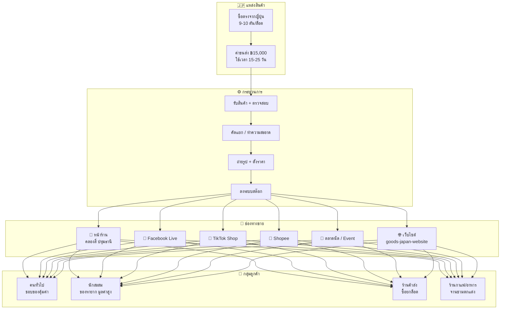

---


## 2. ทำเลที่ตั้งและแผนผังร้าน

### 2.1 ข้อมูลพื้นที่ตั้ง (สาขาในสถานีบริการน้ำมัน ปตท.)

ร้านตั้งอยู่ใน **สถานีบริการน้ำมัน ปตท. (PTT Station) โซนคลอง 3 - คลอง 4 ปทุมธานี** บริเวณใกล้เคียงร้าน Café Amazon (เยื้องขวา 2-3 ล็อค)

| รายละเอียด | ข้อมูล |
|-----------|-------|
| ประเภทพื้นที่ | ห้องพาณิชย์รีเทล 1 ชั้น (รูปแบบ Open Air) |
| รูปแบบหน้าร้าน | เปิดโล่ง (Open Air) ไม่มีกระจก ไม่มีแอร์ เน้นเข้าถึงง่าย |
| ค่าเช่าพื้นที่ | ฿10,000 / เดือน (สัญญาเช่าจัดทำในนามผู้จัดการฝ่ายบริหาร) |
| ระบบปิดร้าน | ประตูม้วนเหล็กชัตเตอร์ (Roller Shutter) ปิดล็อกมิดชิดตอนค่ำ |
| ร้านค้าข้างเคียง | Café Amazon, 7-Eleven, ศูนย์บริการรถยนต์, ร้านอาหารในปั๊ม |
| ที่จอดรถ | ลานจอดรถขนาดใหญ่ของสถานีบริการ ปตท. (จอดได้หลายสิบคัน ปลอดภัย สว่าง 24 ชม.) |
| ระบบความปลอดภัย | มี รปภ. ปั๊ม, กล้องวงจรปิดรอบสถานี, แสงสว่างตลอด 24 ชม. |

### 2.2 ข้อได้เปรียบของรูปแบบ Open Air ในปั๊ม ปตท.

1. **ไร้กำแพงกั้น (Zero Barrier to Entry):** ลูกค้าที่มาแวะซื้อกาแฟ Amazon หรือเข้าห้องน้ำ สามารถเดินถือแก้วกาแฟแวะเข้ามาดูและจับต้องสินค้าได้ทันทีโดยไม่ต้องเคอะเขิน ต่างจากห้องกระจกปิดทึบที่คนมักลังเลไม่กล้าผลักประตูเข้า
2. **บรรยากาศตลาดญี่ปุ่นแท้ (Treasure Hunt Vibe):** ของมือสองญี่ปุ่นเข้ากับรูปแบบ Open Air ที่สุด การจัดวางด้วยลังไม้ กระบะชั่งกิโล และราวแขวนเสื้อผ้า จะกระตุ้นความรู้สึกอยากรื้อค้นหาสมบัติ
3. **ลดต้นทุนค่าไฟมหาศาล:** ไม่ต้องเปิดแอร์สู้แดดในปั๊ม ค่าไฟลดลงจากหลักหลายพันเหลือเพียงหลักร้อยถึงพันต้นๆ (เฉพาะแสงสว่างและพัดลม)
4. **เกราะกำบังทางกฎหมายและระเบียบท้องถิ่น:** การตั้งในปั๊ม ปตท. ช่วยลดปัญหาภาษีป้าย เทศกิจตรวจทางเท้า และปัญหาตำรวจจราจรล็อกล้อลูกค้า

### 2.3 การจัดโซนภายในร้านขนาด 5x5 เมตร (Maximum Density "Treasure Hunt" Layout)

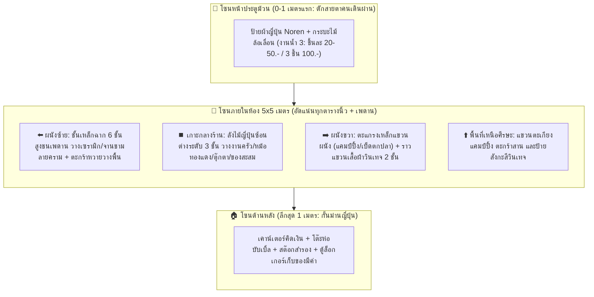

### 2.4 คำแนะนำการจัดวางและดูแลร้าน Open Air 5x5m

| หัวข้อ | คำแนะนำ |
|--------|---------|
| **การใช้พื้นที่แนวตั้ง (Vertical Space)** | ใช้ชั้นเหล็กฉากสูง 2 เมตร (5-6 ชั้น) ชิดผนัง และใช้ตะแกรงเหล็กแขวนผนัง เพื่ออัดสินค้าให้แน่นเต็มตา สร้างบรรยากาศคลังสมบัติญี่ปุ่น (เหมือนร้านในย่าน Shimokitazawa / Hard-Off) |
| **แสงสว่าง** | ติดไฟสปอตไลท์/ดาวน์ไลท์ Warm White (แสงส้มอุ่น 3000K) ให้สว่างชัดเจน ทำให้เซรามิก ทองแดง และงานไม้ดูมีราคาขึ้น 30-50% ดึงดูดสายตาคนขับรถช่วงค่ำ |
| **การป้องกันฝุ่น** | เซรามิกและอุปกรณ์แคมป์ปิ้งใช้ไม้ปัดฝุ่นประจำวัน ส่วนเสื้อผ้า/ตุ๊กตา/ของสะสมให้ใส่ถุงแก้วใสหรือจัดวางในโซนลึก |
| **การกันละอองฝน** | ติดตั้งผ้าใบชักรอกใสด้านหน้า สำหรับดึงลงมาป้องกันละอองฝนเวลาพายุเข้า |
| **ดนตรีสร้างบรรยากาศ** | เปิดเพลงญี่ปุ่นบรรเลงหรือ City Pop เบาๆ สร้างความรู้สึกเหมือนเดินเล่นในตลาดวินเทจญี่ปุ่น |

---

## 3. วิเคราะห์ตลาด กลุ่มลูกค้า และกำลังซื้อ

### 3.1 ศักยภาพทำเล วงแหวน-รังสิต คลอง 4

โซนคลอง 4 เป็นทำเลที่มีหมู่บ้านจัดสรรหนาแน่นมากที่สุดแห่งหนึ่งในปทุมธานี มีทั้งบ้านเดี่ยว บ้านแฝด ทาวน์โฮม คอนโด หอพัก และอพาร์ทเม้นท์ กระจายตลอดเส้นถนนเลียบคลอง 4 ตั้งแต่ฝั่งธัญบุรี-รังสิต ไปจนจรดฝั่งลำลูกกา

> [!IMPORTANT]
> **ข้อได้เปรียบที่สำคัญที่สุดสำหรับร้าน Goods Japan:**
> หมู่บ้านจัดสรรใหม่ = **คนเพิ่งซื้อบ้าน เพิ่งย้ายเข้า** = ต้องการ **เฟอร์นิเจอร์ จานชาม ของแต่งบ้าน** ในราคาจับต้องได้!
> 
> สินค้ามือสองญี่ปุ่น (เฟอร์นิเจอร์ไม้ เซรามิก ของตกแต่ง) ตอบโจทย์กลุ่มคนเหล่านี้ได้พอดี:
> - **ราคาถูกกว่ามือหนึ่ง 50-80%** แต่คุณภาพดี
> - **ดีไซน์ญี่ปุ่นมินิมอล** เข้ากับบ้านสไตล์ Modern Japanese (เช่น MODEN จาก AP) ที่กำลังเป็นเทรนด์
> - **ไม่ซ้ำใคร** — ของมือสองทุกชิ้นมีเพียงชิ้นเดียว

### 3.2 รายชื่อหมู่บ้านและโครงการหลักรอบร้าน

#### 🏠 บ้านเดี่ยว & บ้านแฝด (ระดับราคา 3-8 ล้าน — กำลังซื้อสูง)

| โครงการ | เครือ | ระดับราคา | สินค้าที่น่าเสนอ |
|---------|-------|-----------|-----------------|
| **MODEN รังสิต-คลอง 4 วงแหวน** | AP Thailand | 4-6 ล. | เฟอร์นิเจอร์สไตล์ Japanese 🎯 |
| **Villaggio รังสิต-คลอง 4** | Land & Houses | 3-6 ล. | เฟอร์นิเจอร์ เซรามิก ของแต่งบ้าน |
| **ชัยพฤกษ์ 2 รังสิต-คลอง 4** | Land & Houses | 5-8 ล. | เฟอร์นิเจอร์หรู เซรามิกพรีเมียม |
| **แลนซีโอ คริป (Lanceo CRIB) วงแหวน-ลำลูกกา** | Lalin | 4-6 ล. | เฟอร์นิเจอร์ ของแต่งบ้าน |
| เดอะ วิลเลจ วงแหวน-รังสิต (The Village) | Areeya | 3-5 ล. | เฟอร์นิเจอร์ ของแต่งสวน |
| อินิซิโอ รังสิต-คลอง 4 (Inizio) | Land & Houses | 3-5 ล. | ของแต่งบ้าน จานชาม |
| ดิสคัฟเวอรี่ บาหลีไฮ (Discovery Balihai) | - | 3-5 ล. | ของแต่งบ้านสไตล์รีสอร์ท |
| ดิสคัฟเวอรี่ เพลส (Discovery Place) | - | 3-5 ล. | เฟอร์นิเจอร์ เซรามิก |
| S Ville รังสิต-ลำลูกกา คลอง 4 | - | 3-5 ล. | เฟอร์นิเจอร์ ของแต่งบ้าน |
| บ้านซื่อตรง รังสิต คลอง 4 | - | 2-4 ล. | จานชาม ของแต่งบ้าน |
| บ้านณัฐกานต์ คลอง 4 | - | 2-4 ล. | จานชาม ของแต่งบ้าน |
| สราญสิริ รังสิต | แสนสิริ | 5-8 ล. | เซรามิกพรีเมียม ของสะสม |
| กรีนวิลล์ (Greenville) | - | 2-4 ล. | เฟอร์นิเจอร์ จานชาม |
| เดอะ ริเวียร่า (The Riviera) | - | 3-5 ล. | ของแต่งบ้าน เซรามิก |
| บ้านสถาพร | - | 2-4 ล. | จานชาม ของใช้ในบ้าน |
| บ้านบุรีรมย์ รังสิต-ลำลูกกา คลอง 4 | Lalin | 3-5 ล. | เฟอร์นิเจอร์ ของแต่งบ้าน |

#### 🏘️ ทาวน์โฮม & บ้านแฝด (ระดับราคา 1.7-3 ล้าน — กำลังซื้อปานกลาง)

| โครงการ | เครือ | ระดับราคา | สินค้าที่น่าเสนอ |
|---------|-------|-----------|-----------------|
| **Pleno Town รังสิต คลอง 4 - วงแหวน** | AP Thailand | 2-3 ล. | จานชาม ของแต่งบ้านราคาดี |
| **เซนโทร รังสิต คลอง 4 - วงแหวน (Centro)** | AP Thailand | 2-3 ล. | เฟอร์นิเจอร์ชิ้นเล็ก |
| **พลีโน่ รังสิต คลอง 4 - วงแหวน (Pleno)** | AP Thailand | 2-3 ล. | ของแต่งบ้าน จานชาม |
| **Siri Town รังสิต-คลอง 4** | แสนสิริ | 2-3 ล. | ของแต่งบ้าน จานชาม |
| เดอะ คัลเลอร์ส วงแหวน-รังสิต (The Colors) | Areeya | 2-3 ล. | ของแต่งบ้าน เสื้อผ้า |
| เดอะ คัลเลอร์ส พรีเมียม (The Colors Premium) | Areeya | 2-3 ล. | ของแต่งบ้าน จานชาม |
| Lio BLISS รังสิต-คลอง 4 | Lalin | 1.7-2.5 ล. | จานชาม เสื้อผ้า จิปาถะ |
| Lio วงแหวน-ลำลูกกา คลอง 4 | Lalin | 1.7-2.5 ล. | จานชาม เสื้อผ้า |
| ไอลีฟ ไพร์ม วงแหวน-รังสิต คลอง 4 | - | 2-3 ล. | ของแต่งบ้าน จานชาม |
| เอ็มไลฟ์ ลำลูกกา-คลอง 4 | - | 2-3 ล. | จานชาม ของแต่งบ้าน |
| ยูนิโอ ทาวน์ ลำลูกกา คลอง 4 | - | 2-3 ล. | ของแต่งบ้าน จานชาม |
| พฤกษาวิลล์ รังสิต-คลอง 4 (Pruksa Ville) | Pruksa | 2-3 ล. | จานชาม ของแต่งบ้าน |
| เดอะ แพลนท์ รังสิต-คลอง 4 (The Plant) | Pruksa | 2-3 ล. | เฟอร์นิเจอร์ชิ้นเล็ก |
| บ้านพฤกษา (หลายเฟส) | Pruksa | 1.5-2.5 ล. | จานชาม เสื้อผ้า จิปาถะ |
| เพฟ รังสิต (Pave) | SC Asset | 2-3 ล. | ของแต่งบ้าน จานชาม |

#### 🏢 คอนโด & หอพัก (ค่าเช่า 2,500-7,000 บ./เดือน — กลุ่มเสื้อผ้า ของจุกจิก)

| โครงการ/ประเภท | ค่าเช่าเฉลี่ย | สินค้าที่น่าเสนอ |
|----------------|-------------|-----------------|
| เสนาคิทท์ รังสิต-คลอง 4 (คอนโด) | 6,000-7,200 | เซรามิกชิ้นเล็ก ของแต่งห้อง |
| หอพัก/อพาร์ทเม้นท์ แถวคลอง 4 (มากกว่า 50 แห่ง) | 2,500-4,000 | เสื้อผ้ามือสอง ของจุกจิก |
| หอพักนักศึกษา ม.ธรรมศาสตร์/ม.รังสิต | 2,800-4,500 | เสื้อผ้าวินเทจ กระเป๋า ของสะสม |

### 3.3 ประมาณการกำลังซื้อรอบร้าน

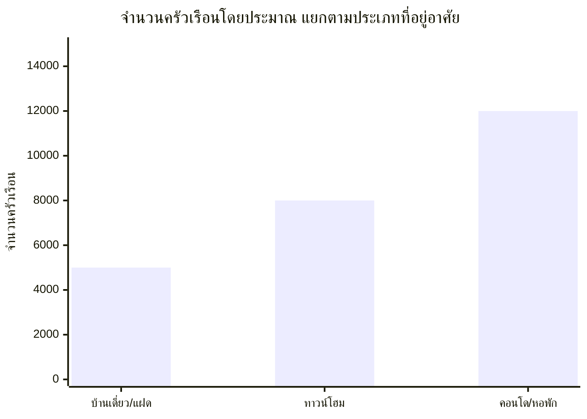

| ประเภท | จำนวนครัวเรือน (ประมาณ) | กำลังซื้อเฉลี่ย/ครั้ง | โอกาสซื้อ/ปี | มูลค่าตลาดรวม/ปี |
|--------|----------------------|---------------------|------------|-----------------|
| บ้านเดี่ยว/แฝด | ~5,000 | ฿500-3,000 | 2-4 ครั้ง | **฿5-60 ล้าน** |
| ทาวน์โฮม | ~8,000 | ฿200-1,000 | 2-3 ครั้ง | **฿3.2-24 ล้าน** |
| คอนโด/หอพัก | ~12,000 | ฿100-500 | 1-2 ครั้ง | **฿1.2-12 ล้าน** |
| **รวม** | **~25,000** | | | **฿9.4-96 ล้าน** |

> [!TIP]
> แค่ดึงลูกค้าจากกลุ่มนี้ได้ **1%** ก็ = ยอดขาย **฿94,000-960,000/ปี** แล้ว! ซึ่งตลาดมีขนาดใหญ่เกินพอสำหรับเป้าหมายยอดขาย ฿150,000/เดือน

### 3.4 กลุ่มลูกค้าเป้าหมายแยกตามความต้องการ

| กลุ่ม | สินค้าที่ต้องการ | วิธีเข้าถึง | ข้อได้เปรียบของ Goods Japan |
|-------|-----------------|------------|--------------------------|
| 🏠 **คนเพิ่งซื้อบ้านใหม่** | เฟอร์นิเจอร์ ชั้นวาง โต๊ะ ตู้ จานชาม ของแต่งบ้าน | FB Ads ปักหมุดรัศมีเส้นคลอง 4 | **ราคาถูกกว่า IKEA/HomePro 50-80%** ดีไซน์ญี่ปุ่นสวยกว่า |
| 🎓 **นักศึกษา ม.ธรรมศาสตร์/ม.รังสิต** | เสื้อผ้าวินเทจ กระเป๋า ของสะสม ฟิกเกอร์ | TikTok + ตลาดนัดหน้ามหาวิทยาลัย | **ของแท้จากญี่ปุ่น** ราคานักศึกษาซื้อได้ |
| ☕ **ร้านกาแฟ/ร้านอาหาร** | เซรามิก จานชาม แก้ว ของตกแต่งร้าน | LINE OA + ขายส่งราคาพิเศษ | **จานชามญี่ปุ่นแท้** ทำให้ร้านดูพรีเมียม ลูกค้าถ่ายรูปลงโซเชียล |
| 👨‍👩‍👧‍👦 **ครอบครัว** | ของเล่นเด็ก เครื่องครัว จิปาถะ | FB + หน้าร้าน walk-in | **ของเล่นญี่ปุ่นคุณภาพดี** ปลอดภัย ราคาย่อมเยา |
| 🔧 **ช่าง/ผู้รับเหมา** | เครื่องมือช่าง อุปกรณ์ | หน้าร้าน walk-in | **เครื่องมือญี่ปุ่นทนทาน** ราคาถูกกว่ามือหนึ่ง |

### 3.5 กลยุทธ์ Facebook Ads Location Targeting

> [!TIP]
> **วิธีใช้ข้อมูลหมู่บ้านทำโฆษณา:** นำชื่อหมู่บ้านเหล่านี้ไปตั้งค่า Location Targeting ใน FB Ads โดยปักหมุดรัศมี 3-5 กม. เฉพาะเส้นคลอง 4 จะดึงคนเข้าร้านหน้าร้านได้อย่างแม่นยำ
>
> **ข้อความโฆษณาตัวอย่าง:** *"เพิ่งย้ายเข้าบ้านใหม่? หาจานชามเซรามิก ของแต่งบ้าน งานแคมป์ปิ้งแท้จากญี่ปุ่น ราคาหลักสิบ-หลักร้อย มาที่ Goods Japan ในปั๊ม ปตท. คลอง 4 (ใกล้ Café Amazon จอดรถฟรี!) 🌸"*

---


### 3.6 โครงสร้างอาชีพและประชากรศาสตร์ (คลอง 1 - 7)
จากการสำรวจข้อมูลประชากรในโซนอำเภอคลองหลวงและธัญบุรี (รังสิต-คลอง 1 ถึง 7) พบว่าเป็น **"ทำเลที่มีรายได้เฉลี่ยต่อครัวเรือนสูงสุดเป็นอันดับ 1 ของประเทศไทย"** (ประมาณ 45,729 บาท/เดือน) ประชากรมีความหลากหลายทางอาชีพสูง แบ่งได้ดังนี้:
1. **พนักงานบริษัทเอกชน/ผู้บริหาร:** อาศัยหนาแน่นในหมู่บ้านจัดสรรโซนคลอง 2, 3, 4 เดินทางเข้า กทม. ด้วยทางด่วน
2. **บุคลากรการศึกษา/นักศึกษา:** กระจุกตัวใกล้ ม.ธรรมศาสตร์, ม.กรุงเทพ (คลอง 1-2) และ มทร.ธัญบุรี (คลอง 6)
3. **ผู้ประกอบการค้าส่ง/ค้าปลีก:** พ่อค้าแม่ค้าและเจ้าของธุรกิจรอบตลาดไท ตลาดไอยรา และตลาดรังสิต
4. **ข้าราชการ/เจ้าหน้าที่รัฐ:** หนาแน่นในโซนคลอง 6 ซึ่งเป็นศูนย์ราชการ (ศาล, อัยการ, ที่ว่าการอำเภอ)
5. **แรงงานและวิศวกร:** จากนิคมอุตสาหกรรมนวนคร (คลอง 1)
6. **เกษตรกรเฉพาะทาง:** โซนคลอง 6-7 เป็นแหล่งผลิตหญ้าปูสนามจัดสวนที่ใหญ่ที่สุดในประเทศ

> [!IMPORTANT]
> **ความแตกต่างของทำเล (Spatial Differences)**
> - **คลอง 1-3:** โซนเมืองหนาแน่น ทุนหนา ประชากรแฝงสูง (นักศึกษา, พนักงาน, พ่อค้า) นิยมพักคอนโด/หอพัก
> - **คลอง 4 (ที่ตั้งร้าน):** เป็น "จุดเชื่อมต่อพรีเมียม" ติดมอเตอร์เวย์วงแหวนตะวันออก เป็นดงหมู่บ้านจัดสรรราคาแพง (3-10 ล้านบาท) ผู้อยู่อาศัยเป็นกลุ่มผู้บริหาร เจ้าของธุรกิจ ที่ต้องการความสงบแต่เดินทางสะดวก กำลังซื้อสูงมาก
> - **คลอง 5-7:** โซนศูนย์ราชการ มหาวิทยาลัย (คลอง 6) โลจิสติกส์ (ดูโฮม คลอง 7) และพื้นที่สีเขียว


## 4. วิเคราะห์คู่แข่งและกลยุทธ์การตั้งราคา

### 4.1 ข้อมูลคู่แข่งและโกดังญี่ปุ่นในพื้นที่ (รังสิต-ลำลูกกา-คลองหลวง)
ย่านนี้ถือเป็น "ศูนย์รวมโกดังสินค้าญี่ปุ่น" ที่สำคัญ มีคู่แข่งที่น่าสนใจดังนี้:

| ชื่อร้าน | ทำเลที่ตั้ง | จุดเด่น | สินค้าหลัก |
|---------|-----------|--------|-----------|
| **TAMAYA** | ลำลูกกา คลอง 4 | คัดเกรดพรีเมียม จัดร้านสวย | เฟอร์นิเจอร์, ไม้, เซรามิก, ของเล่น |
| **Japan Life Center** | พหลโยธิน 75 (ตรงข้ามเซียร์) | โกดังขนาดใหญ่มาก มีของทุกประเภท | เฟอร์นิเจอร์, แคมป์ปิ้ง, จักรยาน, ของจุกจิก |
| **Yone (โยเนะ)** | ลำลูกกา 13 & รังสิต-นครนายก 30 | ร้านสะอาด มีความเป็นระเบียบ มีคาเฟ่ | เซรามิก, เครื่องครัว, ของแต่งบ้าน |
| **Tomizawa** | โฮมโปร ฟิวเจอร์พาร์ค รังสิต | ขายเฟอร์นิเจอร์โดยเฉพาะ เน้นแบรนด์และคุณภาพ | โต๊ะทำงาน, เก้าอี้สำนักงาน, ตู้เก็บของ |
| **WATTMANN** | สามโคก ปทุมธานี | โกดังใหญ่ แพ็คถุงใสอย่างดี ของสะสมเยอะ | อุปกรณ์กีฬา, แคมป์ปิ้ง, กล้องฟิล์ม, โมเดล |

### 4.2 การวิเคราะห์กลยุทธ์การตั้งราคา และ "กฎเหล็ก 3 น้ำ" (Pricing & 3-Tier Financial Rule)

จากการสำรวจโกดังในพื้นที่ควบคู่กับสูตรบริหารสต๊อกของ Goods Japan ร้านจะใช้ **"กฎเหล็กการคัดแยก 3 น้ำ"** เพื่อบริหารกระแสเงินสดให้คืนทุนไวที่สุดและไม่จมสต๊อก:

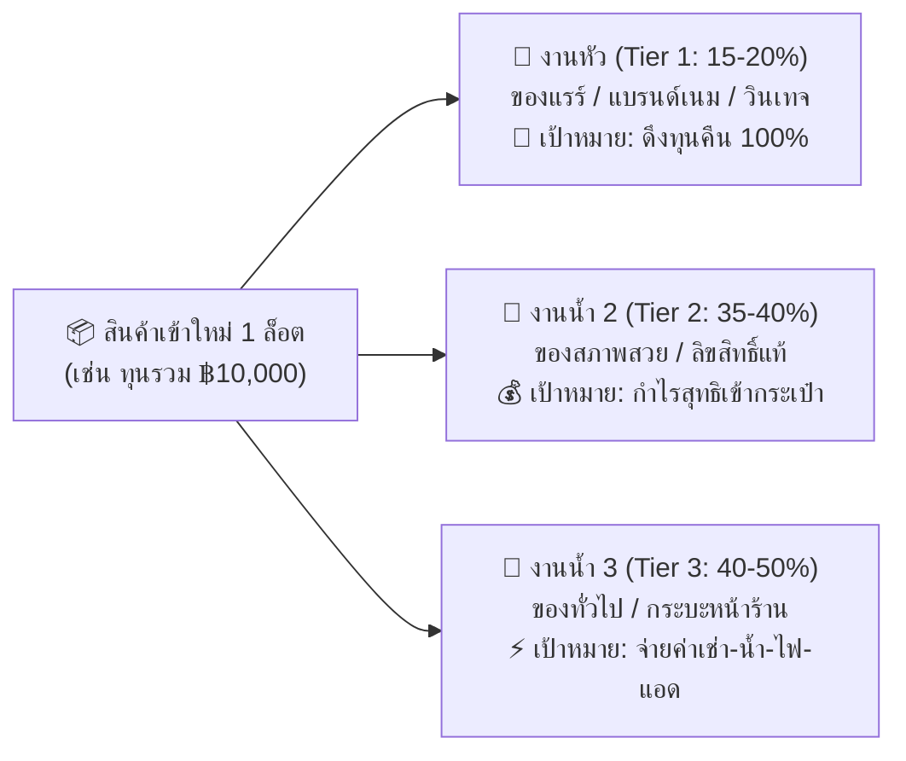

| ระดับสินค้า | สัดส่วน | บทบาททางการเงิน | ตัวอย่างสินค้าจริง & กลยุทธ์ราคา |
|-----------|:------:|----------------|------------------------------|
| **🥇 งานหัว (Tier 1)** | 15–20% | **ดึงเงินทุนคืนทั้งล็อต (100% Break-Even)**<br>ขายงานหัวหมด = ล็อตนั้นไม่มีวันขาดทุน | • หม้อทองแดงแท้ Grace (฿950–1,450)<br>• เครื่องทำพาสต้าอิตาลี Marcato (฿890–1,450)<br>• เตาแก๊สพกพา Iwatani / มีดเชฟญี่ปุ่น (฿590–890)<br>• เครื่องไสน้ำแข็ง Hello Kitty 1976 / เทเลทับบี้ส์หน้ายาง (฿350–450) |
| **🥈 งานน้ำ 2 (Tier 2)** | 35–40% | **กำไรเนื้อๆ เข้ากระเป๋า (Pure Profit)**<br>ตั้งราคา Sweet-Spot ซื้อง่าย ออกไว | • จานชามเซรามิกลายคราม / ถ้วยราเมงพร้อมฝา (฿80–250)<br>• แก้วมัคลิขสิทธิ์ Snoopy, Disney, Miffy (฿80–150)<br>• กาต้มน้ำสแตนเลส / กระทะเหล็กหล่อ (฿250–450)<br>• ตุ๊กตาโมจิไซส์กอด / Sanrio แท้ป้ายห้อย (฿120–250) |
| **🥉 งานน้ำ 3 (Tier 3)** | 40–50% | **เลี้ยงร้าน & ดึงคนมุง (OpEx & Traffic Magnet)**<br>หมุนเงินสดรายวันจ่ายค่าเช่า-ค่าจ้างพนักงาน | • ถ้วยน้ำจิ้ม แก้วน้ำใส จานเล็ก ของจุกจิก ตุ๊กตาตัวเล็ก<br>• จัดใส่กระบะไม้หน้าร้าน **"ชิ้นละ 20–50 บาท / 3 ชิ้น 100 บาท"** หรือชั่งกิโลขาย (฿100–250/กก.) เพื่อดึงลูกค้าจาก Café Amazon ให้แวะมุงรื้อของ |


## 5. กลยุทธ์พอร์ตสินค้าตามไลฟ์สไตล์ชุมชน (Lifestyle Product Strategy)

จากการวิเคราะห์พฤติกรรมผู้อยู่อาศัยในคลอง 4 รังสิตและปทุมธานี พบว่ากิจกรรมกลางแจ้ง (Outdoor) เป็นส่วนหนึ่งของวิถีชีวิต ร้านจึงควรกำหนดสัดส่วนสินค้า (Product Mix) ให้สอดคล้องกัน:

### 5.1 โอกาสจากกลุ่มนักตกปลา (Fishing)
- **ศักยภาพพื้นที่:** คลองรังสิตประยูรศักดิ์และคลองสาขา (คลอง 1-15) เป็นหมายตกปลาธรรมชาติยอดฮิต มีปลาเกล็ด (นิล, ตะเพียน) และปลาชะโด นอกจากนี้ยังมีบ่อตกปลาพาณิชย์หนาแน่น (บ่อวิคเตอร์, กัปตันฟิชชิ่งพาร์ค ฯลฯ)
- **สินค้าแนะนำ:** คันชิงหลิว/สปิ๋ว (ความต้องการสูงมาก), รอกและคันเบ็ดแบรนด์ญี่ปุ่น (Shimano, Daiwa มือสอง), กล่องอุปกรณ์, เก้าอี้ตกปลา, สวิง

### 5.2 โอกาสจากกลุ่มแคมป์ปิ้ง (Camping)
- **ศักยภาพพื้นที่:** ถนนรังสิต-นครนายก (คลอง 4) เป็น "ประตูสู่ภาคกลางและตะวันออก" (Gateway) สำหรับคนที่เดินทางไปกางเต็นท์ที่นครนายกและเขาใหญ่ นอกจากนี้ยังมีคาเฟ่แคมป์ปิ้งในพื้นที่จำนวนมาก
- **สินค้าแนะนำ:** 
  - แบรนด์ที่คนตามหา: Snow Peak, Coleman Japan, DOD, SOTO
  - อุปกรณ์ยอดนิยม: เก้าอี้สนามพับได้ (ทรง Kermit), โต๊ะม้วนโรลท็อป, เตาแก๊สพกพา, ตะเกียงน้ำมัน/LED, เครื่องครัวไทเทเนียม, กระติกเก็บความเย็น

### 5.3 โอกาสจากกลุ่มครอบครัวและนักปั่น (Family & Cycling)
- **ศักยภาพพื้นที่:** มี "Solar Track คลอง 4" ซึ่งเป็นลู่ปั่นจักรยานและวิ่งกลางแจ้งระยะทาง 1.9 กม. ที่ดึงดูดคนรักสุขภาพในย่านนี้มาออกกำลังกายทุกเช้าเย็น
- **สินค้าแนะนำ:** 
  - จักรยานแม่บ้านญี่ปุ่น (มีตะกร้าจ่ายตลาด ปั่นในหมู่บ้าน)
  - จักรยานพับได้ (ใส่ท้ายรถไป Solar Track)
  - อุปกรณ์ทำสวน, กระถางบอนไซ, เครื่องมือช่าง (Makita, Ryobi) สำหรับพ่อบ้าน
  - ของเล่นเสริมพัฒนาการ, รถเหล็ก Tomica, โมเดล Bandai สำหรับครอบครัวรุ่นใหม่


## 6. แผนการตลาดและโฆษณา

### 6.1 ช่องทางและงบประมาณ

| ช่องทาง | งบ/เดือน | เป้าหมาย | KPI |
|---------|---------|---------|-----|
| Facebook Ads | ฿3,000 | สร้างการรับรู้ + ดึงคนดูไลฟ์ | ROAS ≥ 3x |
| TikTok Ads | ฿2,000 | เข้าถึง Gen Y/Z | Views + ยอดขายผ่าน Live |
| Shopee Ads | ฿1,000 | เพิ่ม visibility | Click + Conversion |
| LINE OA | ฿1,000 | รักษาลูกค้าเก่า | Repeat Purchase Rate |
| **รวม** | **฿7,000** | | |

### 6.2 Content Strategy รายสัปดาห์

| วัน | Content | ช่องทาง |
|-----|---------|---------|
| จันทร์ | "สินค้ามาใหม่ประจำสัปดาห์" + รูปสวย 5-10 ชิ้น | FB + IG |
| อังคาร | วิดีโอ "เปิดกล่องสินค้าใหม่" (Unboxing) | TikTok |
| พุธ | เล่าเรื่องสินค้า "คุณรู้ไหม? จานใบนี้มาจาก..." | FB |
| พฤหัสบดี | **Facebook Live ขายของ** 16:00-18:00 | FB Live |
| ศุกร์ | Preview สินค้าสำหรับตลาดนัดวันเสาร์ | TikTok + FB |
| เสาร์ | Live สดจากตลาดนัด + รูปบรรยากาศร้าน | TikTok Live |
| อาทิตย์ | รีวิวจากลูกค้า + โปรโมชั่นสัปดาห์หน้า | FB + LINE |

### 6.3 เทคนิค Facebook Live ที่ได้ผล

| ขั้นตอน | เวลา | ทำอะไร |
|---------|------|--------|
| เปิดไลฟ์ | 0-5 นาที | ทักทาย แจ้งไฮไลท์สินค้าวันนี้ "วันนี้มีจานเซรามิกสวย 5 ใบ!" |
| กลางไลฟ์ | 5-90 นาที | โชว์ทีละชิ้น เล่าเรื่อง บอกราคา โชว์ตำหนิ |
| Flash Deal | ทุก 30 นาที | ลดราคาพิเศษ 3 นาที สร้าง FOMO |
| ปิดไลฟ์ | ท้ายๆ | Bundle Deal ซื้อ 3 ชิ้นลดพิเศษ + แจกของรางวัล |

### 6.4 เทคนิค TikTok ที่ได้ผล

| เทคนิค | รายละเอียด |
|--------|-----------|
| **LIVE GMV Max** | ยิงแอดเข้าถึงคนที่ "พร้อมซื้อ" |
| **Door-Buster** | 5 นาทีแรกต้องเปิดด้วยสินค้าเด็ด |
| **Teaser ก่อนไลฟ์** | ถ่ายคลิปสั้น 15 วิ "เย็นนี้มีของดีมาลงนะ 🌸" |
| **Highlight หลังไลฟ์** | ตัดช่วงพีคมาทำวิดีโอสั้น |
| **Storytelling** | เล่าเรื่องราว + ความบันเทิง = Emotional Commerce |

### 6.5 วิธีวัดผลโฆษณา

| ตัวชี้วัด | ค่าเป้าหมาย | ค่าเฉลี่ยตลาด |
|----------|------------|--------------|
| ROAS (Return on Ad Spend) | ≥ 3x | 2-3x |
| Cost per Message | ≤ ฿15 | ฿5-30 |
| Cost per Purchase | ≤ ฿200 | ฿100-500 |
| CTR (Click-Through Rate) | ≥ 2% | 1-3% |

> [!TIP]
> **เคล็ดลับ:** ทดสอบโฆษณาต่อเนื่อง 6-7 วันก่อนประเมินผล ถ้าแคมเปญไหนดี ค่อยๆ เพิ่มงบทีละ 20-30% ทุก 3-4 วัน

---


## 7. แผนการออก Event และกลยุทธ์ระบายสต๊อก

### 7.1 ตลาดนัดที่แนะนำ (เรียงตามความเหมาะสม)

#### ใกล้ร้าน (ปทุมธานี) — แนะนำเริ่มที่นี่ก่อน
| ตลาด | ค่าเช่า | ข้อดี |
|------|---------|------|
| **Meet Market** (หน้ามาร์เก็ตวิลเลจ คลอง 4) | ฿140-200/วัน | 🏆 **ใกล้ร้านที่สุด!** เปิดพฤหัส-ศุกร์ |
| ตลาดรังสิต | ฿120/วัน | ตลาดใหญ่ มีที่จอดรถ |
| ตลาดสัมมากรเมืองเอก | ฿100/วัน | ฐานลูกค้าชุมชน + นักศึกษา ม.รังสิต |

#### กรุงเทพฯ — ขยายเมื่อพร้อม
| ตลาด | ค่าเช่า | ข้อดี |
|------|---------|------|
| ตลาดปัฐวิกรณ์ (นวมินทร์ 72) | ฿330/วัน | แหล่งรวมร้านมือสองญี่ปุ่นใหญ่สุด |
| ตลาดนัดรถไฟ ศรีนครินทร์ | ฿300/วัน | มีโซนวินเทจโดยเฉพาะ |
| ตลาดเลียบด่วน รามอินทรา | ฿300-400/วัน | ตลาดกลางคืน ขนาดใหญ่ |

### 7.2 ต้นทุนการออกร้าน (ต่อครั้ง)

| รายการ | ค่าใช้จ่าย |
|--------|----------|
| ค่าเช่าพื้นที่ | ฿100-400 |
| ค่าน้ำมัน/ขนส่ง | ฿200-500 |
| ค่าอาหาร/เครื่องดื่ม | ฿200 |
| ค่าอุปกรณ์ (เต็นท์/โต๊ะ) | ฿0 (ซื้อครั้งเดียว) |
| **รวม** | **฿500-1,100/ครั้ง** |

### 7.3 เป้าหมายยอดขายต่อครั้ง

| ระดับ | ยอดขาย | กำไร (หลังหักค่าใช้จ่าย) |
|-------|--------|--------------------------|
| ต่ำสุด (Break-even) | ฿2,000 | ฿0 |
| ปกติ | ฿5,000-8,000 | ฿3,000-5,000 |
| ดีมาก | ฿10,000+ | ฿7,000+ |

> [!IMPORTANT]
> **งาน Japan Event ใหญ่ๆ** (NIPPON HAKU ฿85,000-107,000, Japan Expo ต้องสอบถาม) — **ค่าบูธแพงมาก ยังไม่เหมาะกับตอนนี้**
> แนะนำเริ่มจากตลาดนัดท้องถิ่นก่อน พอยอดขายเพิ่มค่อยพิจารณา

---


### 7.4 ทำไมต้องระบายสินค้าค้าง?

สินค้าที่ค้างเกิน 3 เดือน (โดยเฉพาะเสื้อผ้าและของชิ้นใหญ่ที่ไม่ออก) จะ:
- กินพื้นที่ร้านขนาด 5x5 ม. ในปั๊ม ปตท. (ค่าเช่า ฿10,000/เดือน ที่ทุกตารางนิ้วต้องทำเงิน)
- เงินทุนจม ไม่หมุนเวียน
- สินค้าเสื่อมสภาพ (ฝุ่นจับ, เหม็นอับ, สีซีด)

### 7.5 ช่องทางระบายสินค้า

| ช่องทาง | ข้อดี | ข้อเสีย |
|---------|------|---------|
| **ตลาดนัด** (แนะนำ 🌟) | ค่าเช่าถูก (฿100-200), ตรงกลุ่มเป้าหมาย, มีไฟส่อง | ต้องขนของไป |
| เปิดท้ายรถกระบะ | ไม่เสียค่าเช่า | เสี่ยงเทศกิจ, ไม่มีที่บังแดดฝน |
| ขายยกล็อตให้ร้านค้าส่ง | ได้เงินก้อน, หมดปัญหาทีเดียว | ราคาต่ำมาก |
| ไลฟ์สด Flash Sale | ไม่ต้องขนของ | ค่าส่ง, ต้องมีฐานคนดู |

### 7.6 เทคนิคการขายในตลาดนัด

| เทคนิค | วิธีทำ | ผลลัพธ์ |
|--------|-------|--------|
| **ราคาเลขกลมๆ** | "ตัวละ 39.- / 3 ตัว 100.-" | ลูกค้าตัดสินใจซื้อง่าย ซื้อทีละหลายตัว |
| **รื้อกระบะ (Treasure Hunt)** | กองเสื้อผ้าในกระบะไม้ + ป้ายใหญ่ "นำเข้าจากญี่ปุ่นแท้ ทุกชิ้น 50.-" | คนมุงรื้อหาของ ยิ่งคนเยอะยิ่งดึงคนมาดู |
| **บุฟเฟ่ต์ถุง** | ให้ถุงพลาสติก 1 ใบ "ยัดได้เท่าไหร่ เอาไป ถุงละ 199.-" | ระบายของเร็วมาก + เป็น Content ไวรัลใน TikTok |

### 7.7 Cross-Selling กลับมาที่ร้านหลัก

> [!IMPORTANT]
> **อย่าปล่อยให้ลูกค้าซื้อของถูกแล้วจากไป ต้องดึงเขามาเป็นลูกค้าประจำของร้านใหญ่!**

- ทำป้ายไวนิลบอกชัดเจนว่ามาจากร้านไหน: **"Goods Japan ลดล้างสต๊อก! แวะดูของพรีเมียมได้ที่หน้าร้าน คลอง 4"**
- QR Code ตั้งบนโต๊ะ: **"แอด LINE หรือ Follow TikTok วันนี้ ลดเพิ่ม 10 บาท!"** เพื่อสร้างฐานติดตาม
- แจกนามบัตรร้านทุกถุง

---


## 8. แผนการเงินและกลยุทธ์ลดต้นทุน

### 8.1 โครงสร้างต้นทุนใหม่ (พนักงาน 1 คน ไป-กลับ + บริหารกะค่ำถึง 21.30 น.)

#### อัตราสาธารณูปโภคจริงของสถานีบริการ ปตท.
- **ค่าไฟฟ้า:** หน่วยละ **6.50 บาท** (ร้าน Open Air ไม่มีแอร์ ใช้เฉพาะไฟ LED ส่องสว่างและพัดลม ~120-150 หน่วย/เดือน = ฿800 - ฿1,000)
- **ค่าน้ำประปา:** หน่วยละ **30.00 บาท** (พนักงานไป-กลับ ใช้น้ำน้อยมาก ~3-5 หน่วย/เดือน = ฿100 - ฿150)
- รวมค่าน้ำ-ไฟประมาณการเพียง **~฿1,000 - ฿1,200 / เดือน** (เบิกจ่ายรวมกับค่าตอบแทนผู้จัดการ)

#### ต้นทุนคงที่ (Fixed Costs) ต่อเดือน
| รายการ | จำนวน (บาท) | หมายเหตุ |
|--------|-------------|---------|
| **ค่าเช่าพื้นที่ ปตท.** | 10,000 | 1 ห้อง ชั้นเดียว สัญญาในนามผู้จัดการฝ่ายบริหาร |
| **ค่าจ้างพนักงาน 1 คน** | 9,100 - 10,500 | ค่าจ้างรายวัน ฿350 (ทำ 26 วัน = ฿9,100 / ทำ 30 วัน = ฿10,500) |
| **ค่าน้ำ-ค่าไฟ ปตท.** | 1,000 - 1,200 | น้ำหน่วยละ ฿30, ไฟหน่วยละ ฿6.50 (รวมเบิกจ่ายผ่านผู้จัดการ) |
| **งบการตลาด/ยิงแอด** | 3,000 - 4,000 | Facebook Ads + TikTok Ads (งบกองกลางของร้าน) |
| **ค่าใช้จ่ายเบ็ดเตล็ด** | 1,000 - 1,500 | ถุงพลาสติก, บับเบิ้ลกันกระแทก, น้ำยาทำความสะอาด |
| **รวมต้นทุนคงที่** | **~25,000 - 27,000** | **ลดลงจากแผนเดิม ฿64,000 ไปเกือบ 60%!** 🎯 |

#### ต้นทุนผันแปร (Variable Costs)
| รายการ | สัดส่วน | หมายเหตุ |
|--------|---------|---------|
| ต้นทุนสินค้า (COGS) | ~45% ของยอดขาย | มาร์จิ้นกำไรขั้นต้น 55% |
| ส่วนแบ่งผู้บริหารร้าน | 10% ของยอดขายหน้าร้าน | ตามสัญญาจ้างบริหารและทำการตลาด |
| ค่าส่งสินค้า | ลูกค้าจ่าย | จัดส่งขนส่งเอกชน (Flash, J&T) |

### 8.2 ผลประกอบการ 3 Scenarios (คำนวณจากต้นทุนคงที่ใหม่ ~฿26,500)

```mermaid
xychart-beta
    title "ผลประกอบการรายเดือน 3 Scenarios ต้นทุนใหม่ (บาท)"
    x-axis ["Conservative (฿60K)", "Moderate (฿100K)", "Target (฿150K)"]
    y-axis "บาท" -10000 --> 150000
    bar [60000, 100000, 150000]
    bar [33000, 55000, 82500]
    bar [6500, 28500, 56000]
```

#### Scenario A: Conservative (ยอดขายเริ่มต้น ฿60,000/เดือน)
| รายการ | จำนวน (บาท) |
|--------|-------------|
| ยอดขาย | 60,000 |
| ต้นทุนสินค้า (45%) | -27,000 |
| **กำไรขั้นต้น (55%)** | **33,000** |
| ต้นทุนคงที่ร้าน | -26,500 |
| **กำไรสุทธิคงเหลือ** | **+6,500** ✅ *(ขายเพียง 60K ก็มีกำไรแล้ว!)* |

#### Scenario B: Moderate (ยอดขายดำเนินงาน ฿100,000/เดือน)
| รายการ | จำนวน (บาท) |
|--------|-------------|
| ยอดขาย | 100,000 |
| ต้นทุนสินค้า (45%) | -45,000 |
| **กำไรขั้นต้น (55%)** | **55,000** |
| ต้นทุนคงที่ร้าน | -26,500 |
| **กำไรสุทธิคงเหลือ** | **+28,500** ✅✅ |

#### Scenario C: Target (ยอดขายตามเป้า ฿150,000/เดือน)
| รายการ | จำนวน (บาท) |
|--------|-------------|
| ยอดขาย | 150,000 |
| ต้นทุนสินค้า (45%) | -67,500 |
| **กำไรขั้นต้น (55%)** | **82,500** |
| ต้นทุนคงที่ร้าน | -26,500 |
| **กำไรสุทธิคงเหลือ** | **+56,000** ✅✅✅ |

### 8.3 Break-even Analysis (จุดคุ้มทุนใหม่)

> [!IMPORTANT]
> **จุดคุ้มทุนใหม่ (Break-even) = ฿48,180 / เดือน เท่านั้น!**
> คำนวณจาก: ต้นทุนคงที่ ฿26,500 ÷ Gross Margin 55% = ฿48,180
> **เฉลี่ยยอดขายเพียงวันละ ฿1,600 เท่านั้น ร้านก็รอดและไม่ขาดทุนแล้ว!**

```
การเปรียบเทียบจุดคุ้มทุน:
  โมเดลเดิม (ตึกแถว 2 ห้อง): ต้องขาย ฿116,364/เดือน (เสี่ยงสูง คืนทุนยาก)
  โมเดล ปตท. 2 พนักงาน:     ต้องขาย ฿69,090/เดือน
  โมเดลปัจจุบัน (ปตท. พนักงาน 1 คน + ผู้จัดการเฝ้ากะค่ำ): ขายเพียง ฿48,180/เดือน (เซฟที่สุด คืนทุนไวมาก!) 🚀
```

### 8.4 ประมาณการยอดขายและกำไรสุทธิรายปี (อ้างอิงต้นทุนคงที่ใหม่ ~฿26,500/เดือน)

| เดือน | ยอดขาย (บาท) | กำไรขั้นต้น (55%) | กำไรสุทธิ (หัก Fixed Cost ฿26.5K) | หมายเหตุ |
|-------|-------------|------------------|----------------------------------|---------|
| เดือน 1 (พ.ย.) | 60,000 | 33,000 | **+6,500** ✅ | เปิดร้าน Grand Opening 11.11 **กำไรตั้งแต่เดือนแรก!** |
| เดือน 2 (ธ.ค.) | 80,000 | 44,000 | **+17,500** ✅ | เทศกาลปีใหม่ คนหาของขวัญ/จัดปาร์ตี้แคมป์ปิ้ง |
| เดือน 3 (ม.ค.) | 100,000 | 55,000 | **+28,500** ✅ | ฐานลูกค้าประจำคลอง 4 เริ่มแน่น + ไลฟ์สดสม่ำเสมอ |
| เดือน 4 (ก.พ.) | 120,000 | 66,000 | **+39,500** ✅ | ขยายฐานออนไลน์ TikTok / Facebook Live + ตลาดนัด |
| เดือน 5 (มี.ค.) | 130,000 | 71,500 | **+45,000** ✅ | หมุนเวียนสต๊อกด้วยกฎ 3 น้ำ คืนทุนไว |
| เดือน 6 (เม.ย.) | 150,000 | 82,500 | **+56,000** 🎯 | แตะเป้าหมายหลัก (Target Scenario) |
| เดือน 7-12 | 150,000/ด. | 82,500/ด. | **+56,000/ด.** | รักษามาตรฐานยอดขายและเติมงานหัวเข้าสม่ำเสมอ |
| **รวมปีที่ 1** | **~฿1,540,000** | **~฿847,000** | **~฿+529,000** 🚀 | **กำไรสุทธิปีแรกกว่าครึ่งล้านบาท จากการคุม Fixed Cost อยู่หมัด** |

---

### 8.5 ตารางเปรียบเทียบกลยุทธ์เพิ่มกำไรและลดต้นทุน

| กลยุทธ์ | ผลลัพธ์ต่อเดือน | ผลลัพธ์ต่อปี | ระดับความยาก |
|---------|---------------|-------------|-------------|
| **ย้ายมาทำเล Open Air ปั๊ม ปตท. + พนักงาน 1 คน** | ลด Fixed Cost ได้ **฿37,500/เดือน** (จาก ฿64K เหลือ ฿26.5K) | ประหยัด **฿450,000/ปี** | ✅ **ทำสำเร็จแล้ว!** |
| **คัดแยกสินค้าตาม "กฎเหล็ก 3 น้ำ"** | ดึงทุนคืนไวจากงานหัว 15-20% แรก ลดเงินจม | หมุนรอบสต๊อกไวขึ้น 2 เท่า | ⭐ |
| **ทำความสะอาด + เพิ่มมูลค่า (Regenerating Value)** | ขัดหม้อทองแดง/ล้างเซรามิก อัพราคาขายได้ +30-50% | กำไรเพิ่ม **฿120,000-180,000/ปี** | ⭐⭐ |
| **Clearance งานน้ำ 3 ที่ค้าง > 3 เดือน** | เทกระบะหน้าร้าน 3 ชิ้น 100.- / ออกตลาดนัด ดึงเงินสดกลับ | คืนเงินทุนหมุนเวียน **฿10,000+/เดือน** | ⭐ |

### 8.6 Flowchart กลยุทธ์บริหารต้นทุนและเร่งกำไร

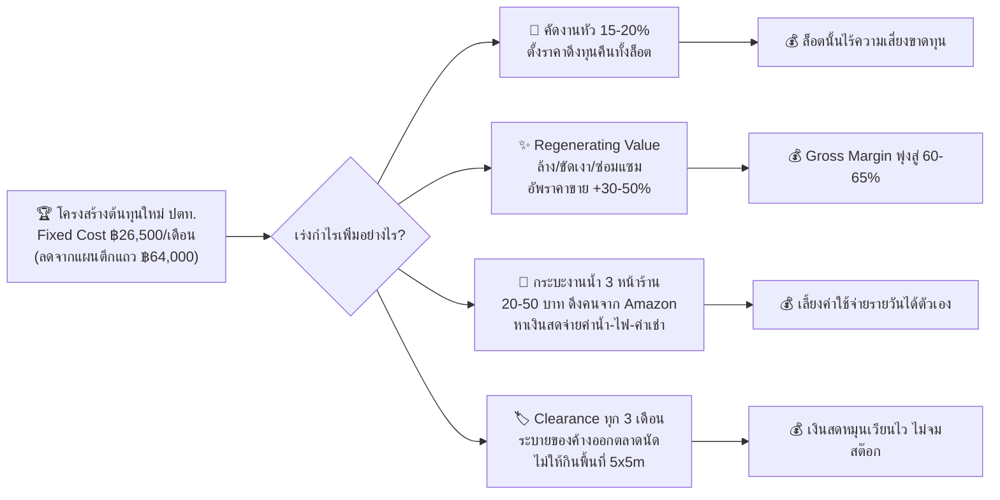

### 8.7 สูตร Regenerating Value (เรียนรู้จาก Treasure Factory)

| ขั้นตอน | รายละเอียด | ผลลัพธ์ |
|---------|-----------|---------|
| 1. รับสินค้า | ซื้อมาราคา ฿50 | ต้นทุน ฿50 |
| 2. ทำความสะอาด | ล้าง ขัด เช็ด (ใช้เวลา 10 นาที) | ต้นทุนเพิ่ม ฿5 |
| 3. ถ่ายรูปสวย | แสงดี ฉากสวย ถ่ายหลายมุม | ต้นทุนเพิ่ม ฿0 |
| 4. เล่าเรื่องราว | ที่มา ยุค ยี่ห้อ ความหายาก | เพิ่มมูลค่าทางจิตใจ |
| 5. **ขาย** | ราคา ฿150-300 แทน ฿100 | **Margin 63-83%** |

> [!TIP]
> **ทำความสะอาดสินค้า 10 นาที = เพิ่มกำไร 30-50% ต่อชิ้น** 
> นี่คือเคล็ดลับของ Treasure Factory ที่ทำ Gross Margin ได้ถึง 65%

---


## 9. คู่มือปฏิบัติงานและการบริหารบุคลากร

### 9.1 ตารางงานรายวัน (เปิด 10:00 – 21:30 น. แบ่ง 2 กะ)

| เวลา | ผู้รับผิดชอบ | งานหลัก | รายละเอียดปฏิบัติการ |
|------|------------|--------|-------------------|
| **10:00–11:00** | 👩‍💼 พนักงานกะกลางวัน | เปิดร้าน & ทำความสะอาด | เปิดประตูม้วนชัตเตอร์, เข็นกระบะงานน้ำ 3 ออกหน้าร้าน, ปัดฝุ่นเช็ดเซรามิก |
| **11:00–12:30** | 👩‍💼 พนักงานกะกลางวัน | คัดแยก & ติดป้ายราคา | ล้างทำความสะอาดของเข้าใหม่, ติดสติกเกอร์ราคาตามโพย 3 น้ำ, ต้อนรับลูกค้า Amazon |
| **12:30–13:30** | 👩‍💼 พนักงานกะกลางวัน | พักรับประทานอาหาร | พักทานมื้อเที่ยงในบริเวณร้าน (พร้อมลุกให้บริการเมื่อมีลูกค้าแวะ) |
| **13:30–16:00** | 👩‍💼 พนักงานกะกลางวัน | ถ่ายรูปสินค้า & แพ็คของ | ถ่ายรูปสินค้า "งานหัว/งานน้ำ 2" ส่งให้ผู้จัดการโพสต์เพจ, แพ็คพัสดุส่งขนส่ง |
| **16:00–17:30** | 👩‍💼 พนักงานกะกลางวัน | เติมของรับรอบเย็น & ส่งกะ | เติมสินค้าหน้าชั้นให้แน่น, นับเงินสดส่งมอบกะให้ผู้จัดการเวลา 17:30 น. |
| **17:30–20:30** | 👨‍💼 ผู้จัดการ (Prime Time) | เชียร์ขายหน้าร้าน & Live สด | รับลูกค้าวัยทำงานแวะปั๊มหลังเลิกงาน, ปิดการขายงานหัว/แคมป์ปิ้ง, ไลฟ์สด FB/TikTok |
| **20:30–21:30** | 👨‍💼 ผู้จัดการ | สรุปบัญชี & ปิดร้าน | เข็นกระบะเก็บเข้าในร้าน, สรุปยอดขายลง Google Sheets, ดึงประตูม้วนล็อกกุญแจ |

### 9.2 ตารางงานรายสัปดาห์

| วัน | งานพิเศษ |
|-----|---------|
| จันทร์ | วางแผนสัปดาห์ + ตรวจสต๊อก + คัดแยกสินค้า 3 น้ำ |
| อังคาร | ถ่ายรูปสินค้าใหม่ (งานหัว & งานน้ำ 2) ลงเพจ |
| พุธ | อัพเดทสินค้าลง Facebook Marketplace / กลุ่มเฉพาะทาง |
| พฤหัสบดี | Facebook Live (รอบค่ำ Prime Time) |
| ศุกร์ | TikTok Live + เตรียมกระบะงานน้ำ 3 สำหรับสุดสัปดาห์ |
| เสาร์ | **วันพีคหน้าร้าน ปตท.** (คนเดินทางไปแคมป์ปิ้ง/เที่ยววันหยุด) หรือออกตลาดนัด |
| อาทิตย์ | **วันพีคครอบครัว** + สรุปยอดขายและกำไรรายสัปดาห์ |

### 9.3 ตารางงานรายเดือน

| สัปดาห์ | งาน |
|---------|-----|
| สัปดาห์ 1 | สรุปยอดเดือนที่แล้ว, จ่ายค่าเช่า-น้ำ-ไฟ ปตท., วางแผนโปรโมชั่นเดือนใหม่ |
| สัปดาห์ 2 | ตรวจสต๊อกแบบ Full Count, ดึงสินค้าค้างลงกระบะ Clearance (งานน้ำ 3) |
| สัปดาห์ 3 | ประเมินผลโฆษณา ROAS, ปรับกลุ่มเป้าหมาย Facebook/TikTok Ads |
| สัปดาห์ 4 | วางแผนสั่งสินค้ารอบถัดไป, สรุปผลประกอบการและส่วนแบ่งบริหาร |

### 9.4 Flowchart การตัดสินใจผู้ประกอบการ (อ้างอิงจุดคุ้มทุนใหม่ ฿48,180)

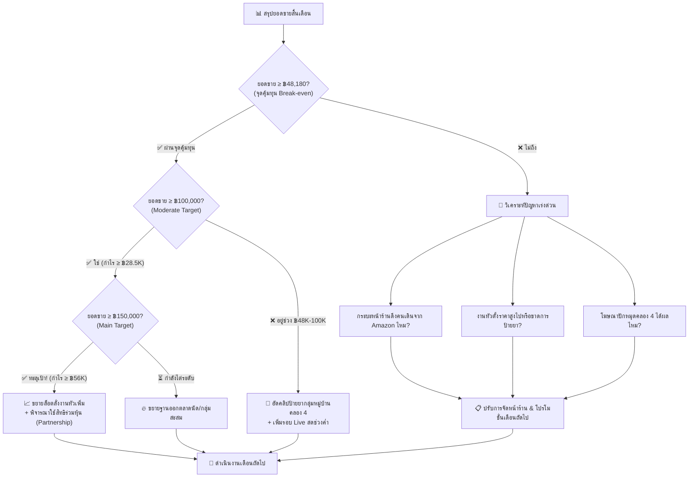

---

### 9.5 แบ่งหน้าที่ความรับผิดชอบ (พนักงานหน้าร้าน 1 คน vs ผู้จัดการฝ่ายบริหาร)

#### 👩‍💼 พนักงานหน้าร้าน (1 คน — กะกลางวัน 10:00–17:30 น.)
| งาน | รายละเอียด | เวลา |
|-----|-----------|------|
| เปิดร้าน & จัดกระบะหน้าประตู | เปิดประตูม้วน, จัดกระบะงานน้ำ 3 ดึงสายตาคนเดินผ่าน | 10:00–10:30 |
| ทำความสะอาด & คัดสินค้า | ล้างจานชาม, ขัดเงาเครื่องครัว, ติดป้ายราคาตามโพย | 10:30–12:30 |
| ต้อนรับลูกค้า Walk-in | ทักทาย, แนะนำโปรโมชั่น 3 ชิ้น 100.-, ห่อบับเบิ้ลกันกระแทก, รับชำระเงิน | ตลอดกะ |
| ถ่ายรูปสินค้า & แพ็คพัสดุ | ถ่ายรูปสินค้ามุม 45°/90° ส่งเข้า LINE กลุ่มร้าน, แพ็คของส่งขนส่ง | 13:30–16:00 |
| ส่งมอบกะ & เคลียร์เงินสด | นับเงินสดทอนและยอดขายรอบวัน ส่งมอบให้ผู้จัดการ | 17:00–17:30 |

#### 👨‍💼 ผู้จัดการฝ่ายบริหาร (กะค่ำ Prime Time 17:30–21:30 น. & บริหารภาพรวม)
| งาน | รายละเอียด | เวลา |
|-----|-----------|------|
| คัดเกรดและเคาะราคา "3 น้ำ" | คัดแยก **งานหัว (เอาทุนคืน) / น้ำ 2 (เอากำไร) / น้ำ 3 (เลี้ยงร้าน)** ทันทีที่ของลง | เมื่อสินค้าเข้า |
| คุมหน้าร้านช่วง Prime Time | รับลูกค้าหมู่บ้านคลอง 4 แวะปั๊มหลังเลิกงาน เชียร์ขายสินค้าชิ้นเด่น | 17:30–21:30 |
| การตลาดออนไลน์ & Live สด | ยิงแอด Facebook/TikTok, โพสต์ป้ายยาสินค้าแรร์, ไลฟ์สดขายของ | ช่วงค่ำ / สุดสัปดาห์ |
| บัญชี & สาธารณูปโภค ปตท. | สรุปยอดรายวันลง Google Sheets, ชำระค่าเช่า ฿10,000 และค่าน้ำ-ไฟปั๊ม | สิ้นวัน / สิ้นเดือน |

### 9.6 มาตรฐานการถ่ายรูปสินค้า

> [!NOTE]
> **หลักการ:** ถ่ายให้สวย แต่ต้องซื่อสัตย์ — โชว์ตำหนิทุกจุดเพื่อสร้างความเชื่อมั่น

| หัวข้อ | มาตรฐาน |
|--------|---------|
| **แสง** | แสงธรรมชาติหน้าร้าน หรือไฟสปอตไลท์ Warm White 3000K ส่องให้เห็นเนื้อวัสดุชัดเจน |
| **ฉากหลัง** | ชั้นไม้จริงในร้าน / ผ้าลินินสีครีม / พื้นไม้สะอาดตา |
| **มุมกล้อง** | จาน/ชาม = 90° (Top View), แก้ว/หม้อทองแดง/ของสูง = 45° + ภาพซูมตราประทับ (Stamp/Mark) |
| **จำนวนรูป** | อย่างน้อย 4 รูป: ภาพรวม, ด้านบน/ด้านหน้า, ตราประทับก้นภาชนะ/ป้ายแท็ก, ตำหนิ (ถ้ามี) |
| **ห้าม** | ❌ ใช้แฟลชสะท้อนขาวโพลน ❌ ฉากหลังรกมีขยะ ❌ ปกปิดรอยบิ่น/รอยบุบ |

### 9.7 Flowchart การคัดแยกและตั้งราคาสินค้าตาม "กฎเหล็ก 3 น้ำ"

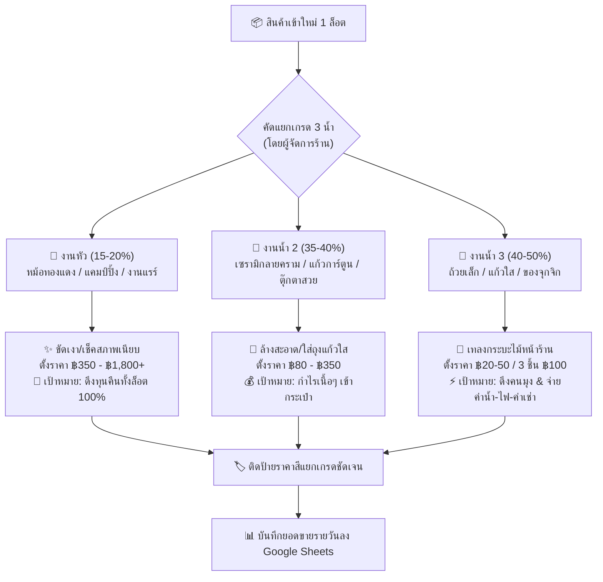

### 9.8 สิ่งที่พนักงานต้องรู้เกี่ยวกับสินค้าญี่ปุ่น

| หัวข้อ | ความรู้ที่ต้องมี |
|--------|-----------------|
| **เซรามิก** | รู้จักยี่ห้อ/แหล่งผลิต: Arita-yaki (อาริตะ), Mino-yaki (มิโนะ), Kutani-yaki (คุทานิ), ชามราเมงขอบทอง |
| **ของสะสม & ตุ๊กตา** | รู้จักป้ายลิขสิทธิ์แท้: Sanrio (Hello Kitty 1976), Snoopy Peanuts, Disney Tokyo, ป้าย Amuse / Bandai |
| **เครื่องครัว & แคมป์ปิ้ง** | รู้จักงานทองแดงแท้ (Copper), เหล็กหล่อ (Cast Iron), เตาแก๊ส Iwatani, แบรนด์ Coleman / Snow Peak |
| **ดูของแท้เบื้องต้น** | พลิกดูตราประทับก้นถ้วย (刻印), สติกเกอร์ Made in Japan, น้ำหนักเนื้อวัสดุ |

### 9.9 การรับมือกับลูกค้า

| สถานการณ์ | วิธีจัดการ |
|-----------|----------|
| ลูกค้าต่อราคา | **งานน้ำ 2-3:** เสนอโปรโมชั่นเหมา (เช่น 3 ชิ้น 100.-) / **งานหัว:** พนักงานลดเองได้ไม่เกิน 5-10% หากเกินกว่านั้นให้โทร/ไลน์ถามผู้จัดการ |
| ลูกค้าถามเรื่องสินค้า | เล่าจุดเด่น เช่น "ใบนี้เป็นงานเขียนลายมือจากญี่ปุ่นค่ะ มีใบเดียวในร้าน" (ถ้าไม่แน่ใจให้ถ่ายรูปถามผู้จัดการทันที) |
| ลูกค้าร้องเรียน | ขอโทษด้วยความสุภาพ + เสนอเปลี่ยนชิ้นใหม่ในมูลค่าเท่ากัน |
| ลูกค้าเดินผ่านจาก Amazon | ยิ้มทักทาย *"สวัสดีค่า ของญี่ปุ่นเข้าใหม่เพียบเลย แวะชมกระบะหน้าร้านก่อนได้นะคะ"* (ไม่เดินตามกดดัน) |
| สินค้าแตกในร้าน | เก็บกวาดทันทีเพื่อความปลอดภัย ถ่ายรูปแจ้งผู้จัดการ (ไม่หักเงินหากเป็นอุบัติเหตุ) |

---

### 9.10 ข้อมูลการจ้างงาน และกระบวนการคัดเลือกพนักงาน (Hiring SOP)

| รายละเอียด | ข้อมูล |
|-----------|-------|
| **จำนวนและคุณสมบัติ** | **1 คน — เพศหญิง อายุไม่เกิน 35 ปี** (บุคลิกยิ้มแย้ม ซื่อสัตย์ ขยัน ไม่ติดมือถือ) |
| **คุณสมบัติพิจารณาพิเศษ** | 🌟 **หากมีความรู้ความเข้าใจเรื่องสินค้ามือสองญี่ปุ่น (จานชาม/งานครัว/ของสะสม) หรือเคยขายของมือสองมาก่อน จะพิจารณาเป็นพิเศษ** |
| **รูปแบบการทำงาน** | **ไป-กลับ (ไม่พักค้างคืนในร้าน)** ทำงานเวลา 10:00 – 17:30 น. |
| **รูปแบบค่าจ้าง** | **ค่าจ้างรายวัน วันละ 350 บาท** (ช่วงทดลองงาน 7 วันแรก วันละ 300–350 บาท) |
| **วันทำงาน** | ทำงาน 26 วัน / เดือน (หยุดสัปดาห์ละ 1 วัน เฉพาะวันธรรมดา จันทร์-พฤหัสฯ **ห้ามหยุดศุกร์-เสาร์-อาทิตย์**) |
| **รายได้ต่อเดือน** | ประมาณ ฿9,100 / เดือน (หากทำครบ 30 วัน = ฿10,500) + พิจารณาปรับขึ้น/มีโบนัสเมื่อผ่านโปรและยอดขายทะลุเป้า |
| **สวัสดิการ** | น้ำดื่มฟรี, พัดลมระบายอากาศ, ส่วนลดซื้อสินค้าในร้าน, โบนัสพิเศษตามเป้า |

> [!TIP]
> **ข้อดีของการจ้างแบบไป-กลับ 1 คน:** ตัดปัญหาเรื่องความปลอดภัยของพนักงานหญิงในเวลากลางคืน ตัดปัญหาค่าเช่าหอพัก และตัดปัญหาบุคคลภายนอกเข้ามามั่วสุมในร้านได้ 100%

#### 📋 ขั้นตอนการคัดกรองและสัมภาษณ์งาน 5 ขั้นตอน (เมื่อมีผู้สนใจสมัครงาน)
1. **ขั้นที่ 1: คัดกรองเบื้องต้นทางแชท/โทรศัพท์ (ถาม 4 ข้อจบใน 2 นาที)**
   - ชื่อเล่น อายุเท่าไหร่ พักอยู่แถวไหน (คลองไหน) และเดินทางมาปั๊ม ปตท. คลอง 4 ด้วยวิธีใด? (ควรเดินทางไม่เกิน 15–20 นาที)
   - เคยทำงานขายของหน้าร้าน แพ็คของ หรือรู้จักสินค้ามือสองญี่ปุ่นมาก่อนไหม?
   - สะดวกเข้างาน **10:00 – 17:30 น.** และหยุดวันธรรมดา (ไม่หยุดเสาร์-อาทิตย์) ได้ใช่ไหม?
   - พร้อมเริ่มงานวันที่ **6 พฤศจิกายน** นี้เลยไหม?
2. **ขั้นที่ 2: นัดสัมภาษณ์ที่สถานที่จริง (Café Amazon ปั๊ม ปตท. คลอง 4)**
   - ใช้เวลาคนละ 15–20 นาที เพื่อดูความตรงต่อเวลา การแต่งกาย และให้ผู้สมัครเห็นห้องร้านจริงขนาด 5x5 ม.
3. **ขั้นที่ 3: ทดสอบไหวพริบหน้างาน (The 3-Minute Practical Test)**
   - หยิบสินค้าจริงไปวาง 3 ชิ้น (เช่น จานเซรามิก 1 ใบ, หม้อทองแดง 1 ใบ, ตุ๊กตา 1 ตัว) แล้วลองให้ผู้สมัครแนะนำขาย และถามวิธีรับมือเมื่อลูกค้าต่อราคาครึ่งหนึ่ง
4. **ขั้นที่ 4: แจ้งข้อตกลงและกฎเหล็กให้ชัดเจนก่อนรับเข้าทำงาน**
   - เน้นเรื่อง **ความซื่อสัตย์ 100%** (เงินสดทุกบาทต้องตรงกับสมุดจด/สลิป QR), **ไม่ก้มเล่นมือถือขณะมีลูกค้าเดินผ่าน**, และ **มีทดลองงาน 7 วันแรก (6–12 พ.ย.)**
5. **ขั้นที่ 5: เอกสารวันเริ่มงาน และสำรองรายชื่ออันดับ 2**
   - วันเริ่มงาน (6 พ.ย.) ให้เตรียมสำเนาบัตรประชาชน + สำเนาทะเบียนบ้าน + หน้าสมุดบัญชีธนาคาร พร้อมทั้ง **เก็บเบอร์ผู้สมัครอันดับ 2 และ 3 ไว้เป็นตัวสำรองเสมอ** เผื่ออันดับ 1 ไม่มาทำงานวันแรก

### 9.11 การจัดกะการทำงาน (Shift Management & Evening Peak)

ร้านเปิดให้บริการตั้งแต่เช้าจรดดึก (10:00 – 21:30 น.) เพื่อเก็บลูกค้ารอบ Café Amazon ช่วงกลางวัน และคนขับรถกลับบ้านช่วงค่ำ:

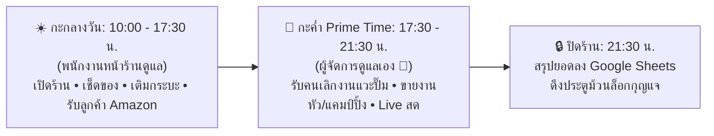

1. **กะกลางวัน (10.00 – 17.30 น. / พนักงานหน้าร้าน):** 
   - รับผิดชอบเปิดร้าน เช็ดฝุ่นสินค้า เติมของลงกระบะหน้าร้าน รับลูกค้าที่แวะมาดื่มกาแฟ Amazon ช่วงกลางวัน
2. **กะค่ำ (17.30 – 21.30 น. / ผู้จัดการร้านดูแลเอง):**
   - ผู้จัดการเข้ามารับช่วงต่อ พนักงานเลิกงานเดินทางกลับบ้าน
   - **ช่วง Prime Time:** ช่วง 17.30 - 21.00 น. เป็นช่วงที่คนทำงานขับรถกลับบ้านแวะเข้าปั๊ม ปตท. มากที่สุด การที่ผู้จัดการอยู่เองจะช่วยเชียร์ขายของมูลค่าสูง (งานหัว, ของแต่งบ้าน, แคมป์ปิ้ง, คันเบ็ด) ได้ยอดขายเต็มเม็ดเต็มหน่วย
   - **ปิดร้าน 21.30 น.:** สรุปยอดขายลงระบบ Google Sheets และดึงประตูม้วนล็อกร้าน

### 9.12 กฎระเบียบสำหรับพนักงานในปั๊ม ปตท.

> [!IMPORTANT]
> **ปั๊ม ปตท. มีระเบียบองค์กรเข้มงวด พนักงานต้องปฏิบัติตามอย่างเคร่งครัด:**
> - รักษาความสะอาดหน้าร้าน ไม่ให้มีขยะหรือสิ่งของกีดขวางทางสัญจรเกินขอบเขตพื้นที่เช่า
> - แต่งกายสุภาพ เรียบร้อย สวมผ้ากันเปื้อนของร้าน
> - ส่งมอบกะและเคลียร์เงินสดในลิ้นชักกับผู้จัดการทุกวันเวลา 17.30 น.

---


## 10. ข้อตกลงหุ้นส่วนและโครงสร้างการบริหารจัดการ

> [!CAUTION]
> **โครงสร้างข้อตกลงและสัญญาจ้างบริหารจัดการร้าน Goods Japan (สาขา ปตท.)**

### 10.1 บทบาทหน้าที่ การถือสัญญาเช่า และค่าสาธารณูปโภค

1. **ผู้ถือสัญญาเช่าพื้นที่:** สัญญาเช่าพื้นที่พาณิชย์ในสถานีบริการน้ำมัน ปตท. **จัดทำในนามของผู้จัดการฝ่ายบริหาร (ตัวคุณ)**
2. **การจ่ายเงินเดือนและสาธารณูปโภค:**
   - ในรอบการจ่ายเงินเดือน/ส่วนแบ่งบริหาร จะคำนวณ **รวมค่าใช้จ่ายค่าน้ำประปาและค่าไฟฟ้าของร้าน** ไปในยอดเดียวกัน เพื่อให้ผู้จัดการเป็นผู้ดำเนินการชำระบิลของปั๊มโดยตรง
   - **อัตราอ้างอิงจริงของปั๊ม ปตท.:**
     - ค่าน้ำประปา: หน่วยละ **30 บาท**
     - ค่าไฟฟ้า: หน่วยละ **6.50 บาท**
3. **ค่าจ้างพนักงานหน้าร้าน:** เบิกจ่ายเป็นค่าแรงรายวัน **วันละ 350 บาท (พนักงาน 1 คน ไป-กลับ)** ตามจำนวนวันที่ปฏิบัติงานจริง (ประมาณ ฿9,100 / เดือน)
4. **การบริหารหน้าร้าน:** ผู้จัดการเป็นผู้ดูแลกะค่ำ (17.30 - 21.30 น.) ด้วยตนเอง เพื่อเร่งยอดขายช่วงคนเลิกงาน

### 10.2 โครงสร้างค่าตอบแทนและส่วนแบ่งรายได้ (Revenue Share Model)

| ประเภทรายได้ | สัดส่วนส่วนแบ่ง | เงื่อนไขการจ่าย |
|-------------|:-------------:|----------------|
| **ยอดขายหน้าร้าน (Store Sales)** | **10% ของยอดขายรวม** | ตัดรอบสิ้นเดือน จ่ายภายในวันที่ 5 ของเดือนถัดไป |
| **ยอดขายตลาดนัด/อีเวนต์ (Flea Market)** | **25% ของยอดขายรวม** | สำหรับสต๊อกที่ผู้จัดการขนออกไปจำหน่ายเองภายนอก |
| **งบโฆษณา/ยิงแอด (Marketing Budget)** | เบิกจ่ายตามจริง | เป็นงบกองกลางของร้าน ไม่หักจากส่วนแบ่งผู้จัดการ |

### 10.3 สิทธิการเข้าร่วมเป็นหุ้นส่วนในอนาคต (Partnership Option)

- การดำเนินงานในระยะเริ่มต้น 3 - 6 เดือนแรก เป็นการจ้างบริหารเพื่อทดสอบระบบและสร้างกำไร
- เมื่อพ้นกำหนดระยะเวลาดังกล่าว ผู้จัดการมี **สิทธิพิเศษ (First Right)** ในการแปลงสภาพเข้าถือหุ้นส่วนในส่วนของทุนและกำไรสุทธิของร้าน Goods Japan ตามสัดส่วนที่จะตกลงกันเป็นลายลักษณ์อักษร

---


## 11. การจัดการความเสี่ยงและแผนขยายกิจการ

### 11.1 Risk Matrix

| ระดับความเสี่ยง | โอกาสเกิดสูง (High Probability) | โอกาสเกิดต่ำ (Low Probability) |
|---|---|---|
| **ผลกระทบสูง (High Impact)** | **จัดการทันที (Critical)**<br>• ยอดขายไม่ถึง Break-even<br>• ขัดแย้งหุ้นส่วน | **เฝ้าระวัง (Monitor)**<br>• พนักงานลาออก |
| **ผลกระทบต่ำ (Low Impact)** | **วางแผนรับมือ (Mitigate)**<br>• คู่แข่งเพิ่ม<br>• สินค้าค้างสต๊อก | **ยอมรับได้ (Accept)**<br>• สินค้าเสียหายขนส่ง<br>• ค่าเช่าขึ้น |

### 11.2 แผนรับมือความเสี่ยง

| ความเสี่ยง | โอกาส | ผลกระทบ | แผนรับมือ |
|-----------|-------|---------|----------|
| ยอดขายไม่ถึง Break-even | สูง | สูงมาก | เพิ่มช่องทางขาย, ออกตลาดนัด, เพิ่มงบโฆษณา |
| สินค้าค้างสต๊อก | ปานกลาง | ปานกลาง | Clearance ทุก 3 เดือน, ลดขนาดออเดอร์ |
| คู่แข่งเพิ่ม | สูง | ปานกลาง | สร้างความแตกต่าง, ความเชี่ยวชาญ, Community |
| พนักงานลาออก | ปานกลาง | สูง | จ่ายตรงเวลา, สอนงานคู่กัน, บรรยากาศดี |
| ขัดแย้งหุ้นส่วน | ต่ำ | สูงมาก | **สัญญาหุ้นส่วนที่ชัดเจน** + ประชุมทุกเดือน |
| สินค้าเสียหายจากขนส่ง | ปานกลาง | ต่ำ | แพ็คอย่างดี, ประกันสินค้าชิ้นแพง |
| ค่าเช่าขึ้น | ปานกลาง | ปานกลาง | ทำสัญญาเช่าระยะยาว 2-3 ปี |

### 11.3 แผนสำรอง (Plan B)

> ถ้าขาดทุนต่อเนื่อง 6 เดือนขึ้นไป:

| ระดับ | เงื่อนไข | การดำเนินการ |
|-------|---------|-------------|
| ⚠️ เฝ้าระวัง | ขาดทุน 3 เดือนติดต่อกัน | วิเคราะห์ + ปรับกลยุทธ์ |
| 🟡 ปรับโครงสร้าง | ขาดทุน 6 เดือน | ลดพื้นที่เช่า, ลดพนักงาน, เน้นออนไลน์ |
| 🔴 Plan B | ขาดทุน 12 เดือน+ | ขายส่งยกตู้คอนเทนเนอร์ (แผนหุ้นส่วน) |
| ⛔ Exit | ขาดทุนสะสม > ฿300,000 | ปิดร้าน, แบ่งทรัพย์สินตามสัญญา |

---


### 11.4 เป้าหมายการเติบโต (Growth Roadmap)

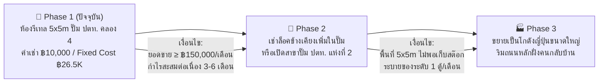

### 11.5 ปัจจัยตัดสินใจย้ายไปที่ดินแปลงใหญ่ (Phase 3)

| ปัจจัย | รายละเอียด |
|--------|----------|
| ทิศทางการจราจร | ต้องอยู่ฝั่ง "คนขับรถกลับบ้าน" (ช่วงเย็น) ลูกค้าแวะจอดซื้อของได้ง่าย |
| ต้นทุนก่อสร้าง | ต้องเทปูน ถมที่ เดินไฟ ทำหลังคา (หลักแสน-ล้าน) ต้องมีกำไรสะสมเพียงพอ |
| ลานจอดรถ | ข้อดีสำคัญ: ลูกค้าซื้อเฟอร์นิเจอร์ต้องใช้รถมาขน + รถคอนเทนเนอร์ถอยเข้าเทของได้ |
| ระบบสาธารณูปโภค | น้ำ ไฟ อินเทอร์เน็ต ต้องตรวจสอบว่าเข้าถึงหรือยัง |

### 11.6 สัญญาณที่บอกว่า "ถึงเวลาขยาย"

> [!IMPORTANT]
> **🚩 Trigger Points — เมื่อเห็นสัญญาณเหล่านี้ คือเวลาที่ต้องพิจารณาย้ายหรือขยาย:**

1. ของแน่นจนไม่มีทางเดิน ลูกค้าเริ่มบ่นว่าเดินชนของในห้อง 5x5 เมตร
2. มีลูกค้าถามหาเฟอร์นิเจอร์ชิ้นใหญ่ (โต๊ะ/ตู้/โซฟา) จำนวนมาก แต่พื้นที่ในปั๊มวางไม่พอ
3. ร้านสามารถระบายของเร็วถึงระดับที่ต้องสั่งของมาลงทีละ 1 ตู้คอนเทนเนอร์เต็มๆ ต่อเดือน
4. ยอดขายทะลุ ฿200,000/เดือน ติดต่อกัน 3 เดือนขึ้นไป

---


## 12. แผนปฏิบัติการเปิดร้านและ Master Checklist 11.11

### 12.1 ไทม์ไลน์ภาพรวมการเปิดร้าน (15 ต.ค. – 11 พ.ย.)

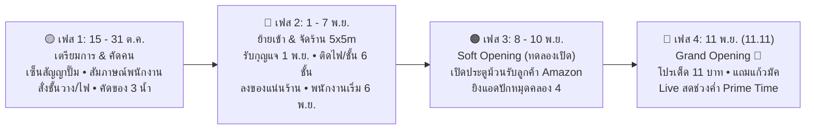

### 12.2 Master Checklist ปฏิบัติการ 4 เฟส

#### 🟡 เฟส 1: เตรียมการ & สัมภาษณ์บุคลากร (15 – 31 ตุลาคม 2569)
- [ ] **สัญญาเช่าพื้นที่:** เซ็นสัญญาเช่าพื้นที่กับทางสถานีบริการ ปตท. ในนามผู้จัดการ (ตรวจสอบมิเตอร์น้ำ 30.- / ไฟ 6.50.-)
- [ ] **สัญญาจ้างบริหาร:** เซ็นสัญญาจ้างบริหารและจัดการร้านกับหุ้นส่วน (ผู้ว่าจ้างรับผิดชอบค่าเช่า ฿10,000 + ค่าน้ำไฟจริง)
- [ ] **การสรรหาพนักงาน:** โพสต์รับสมัครพนักงานหญิง 1 คน (อายุไม่เกิน 35 ปี, ไป-กลับ 10:00–17:30 น., ค่าจ้างรายวัน ฿350, พิจารณาพิเศษหากมีความรู้เรื่องของมือสองญี่ปุ่น)
- [ ] **การสัมภาษณ์งาน:** คัดกรองแชท 4 ข้อ และนัดสัมภาษณ์พร้อมทดสอบไหวพริบที่ Café Amazon ปั๊ม ปตท. สาขาจริง คอนเฟิร์มเริ่มงาน 6 พ.ย.
- [ ] **จัดซื้อชั้นวาง & อุปกรณ์:** สั่งซื้อชั้นเหล็กฉาก 5-6 ชั้น, ตะแกรงแขวนผนัง, สปอตไลท์ Warm White 3000K, และลังไม้ทำเกาะกลาง
- [ ] **ป้ายร้าน:** สั่งทำป้ายผ้าญี่ปุ่น Noren และป้ายไวนิลหน้าร้าน "Goods Japan (กู๊ดส์ เจแปน)"
- [ ] **อุปกรณ์คิดเงิน & แพ็คของ:** เครื่องคิดเลข, ป้ายสแกน QR Code รับเงิน, บับเบิ้ลกันกระแทก, ถุงหิ้ว, สติกเกอร์ราคา, และขาตั้งจาน
- [ ] **เตรียมสต๊อก:** คัดแยก ทำความสะอาดจานชาม และเช็ดฝุ่นสินค้าล็อตแรก
- [ ] **เงินทอน:** สำรองเงินสดทอนหน้าร้าน 2,000 - 3,000 บาท

#### 🔵 เฟส 2: ย้ายเข้าอาคาร & ตกแต่งร้าน (1 – 7 พฤศจิกายน 2569)
- [ ] **1 พ.ย. (วันรับมอบ):** รับมอบกุญแจห้อง, ถ่ายรูปจดเลขมิเตอร์น้ำ-ไฟเริ่มต้น, ทำความสะอาดพื้นห้อง
- [ ] **2 - 3 พ.ย.:** ติดตั้งระบบไฟ Warm White, ปลั๊กไฟ, ประกอบชั้นเหล็ก 6 ชั้น และแขวนตะแกรงผนัง
- [ ] **4 - 5 พ.ย.:** ขนย้ายสินค้าเข้าห้อง จัดเรียงขึ้นชั้น (เซรามิกซ้าย, แคมป์ปิ้งขวา, ลังไม้กลางร้าน, กระบะเทหน้าร้าน)
- [ ] **6 พ.ย. (พนักงานเริ่มงานวันแรก):** สอนงานห่อของกันแตก, การคิดเงิน, การทักทายลูกค้า, และช่วยกันติดป้ายราคา
- [ ] **7 พ.ย.:** ติดตั้งม่านกั้นโซนสต๊อกด้านหลัง และเช็กความพร้อมของระบบล็อกประตูม้วนชัตเตอร์

#### 🟠 เฟส 3: ทดลองเปิดร้าน Soft Opening (8 – 10 พฤศจิกายน 2569)
- [ ] เปิดม้วนประตูรับลูกค้าจริงที่เดินผ่านจาก Café Amazon เพื่อทดสอบความคล่องตัวในการบริการ
- [ ] ทดสอบการบันทึกยอดขายรายวันลงระบบ Google Sheets หลังปิดร้านเวลา 21.30 น.
- [ ] ถ่ายภาพบรรยากาศร้านที่มีของแน่นๆ ลง Facebook Page และ TikTok
- [ ] **เริ่มยิงแอดโฆษณา (9 พ.ย.):** ยิง Facebook Ads ปักหมุดรัศมี 8 กิโลเมตร ประชาสัมพันธ์เปิดร้าน Grand Opening 11.11

#### 🔴 เฟส 4: วันเปิดตัวจริง GRAND OPENING (11 พฤศจิกายน 2569) 🎉
- [ ] **เปิดแคมเปญโปรโมชั่น 11.11:**
  - *ไอเทมเด็ด 11 บาท:* จานรองแก้ว/ถ้วยน้ำจิ้ม 11 บาท (จำกัดคนละ 2 ชิ้น ดักคนเข้าร้าน)
  - *ช้อปครบ 300 บาท:* รับฟรีแก้วมัคญี่ปุ่น 1 ใบ (เตรียมของแถมไว้ 50 ชิ้นแรก)
  - *กระบะเสื้อผ้า 11.11:* เสื้อผ้าวินเทจ 3 ตัว 100.-
- [ ] ผู้จัดการร้านเข้าคุมหน้าร้านเต็มเวลา และไลฟ์สด Facebook/TikTok ในช่วง Prime Time (17.30 - 21.00 น.)
- [ ] สรุปยอดขายวันแรกและวางแผนการเติมสินค้าประจำสัปดาห์! 🚀

---


## 13. กรณีศึกษาธุรกิจที่ประสบความสำเร็จ

### 13.1 🇯🇵 ธุรกิจจากญี่ปุ่น

#### 2nd STREET (セカンドストリート)
| รายละเอียด | ข้อมูล |
|-----------|-------|
| **สาขา** | 1,000+ แห่งทั่วโลก (ญี่ปุ่น, สหรัฐ, ไทย) |
| **กลยุทธ์หลัก** | ระบบรับซื้อมาตรฐานสากล ประเมินราคาชัดเจน จ่ายเงินสดทันที |
| **ทำเล** | ชานเมือง — ลูกค้าขับรถมาขนของมาขายได้ง่าย |
| **บทเรียนสำหรับ Goods Japan** | ✅ สร้างระบบราคาที่ชัดเจน ✅ ทำเลชานเมืองเหมาะกับสินค้าชิ้นใหญ่ |

#### HARD OFF / BOOK OFF / OFF HOUSE
| รายละเอียด | ข้อมูล |
|-----------|-------|
| **จุดเด่น** | แยกหมวดหมู่ชัดเจน (หนังสือ/เครื่องใช้ไฟฟ้า/ของใช้ในบ้าน) |
| **ระบบสต๊อก** | คอมพิวเตอร์ + ส่วนกลางตั้งราคา Fixed Price ไม่ต่อรอง |
| **นวัตกรรม** | ถ่ายโอนสต๊อกระหว่างสาขา — สาขาที่ของล้นส่งไปสาขาที่ขาด |
| **บทเรียน** | ✅ ระบบสต๊อกเป็นหัวใจ ✅ Fixed Price ลดเวลาต่อรอง |

#### Treasure Factory (トレジャーファクトリー)
| รายละเอียด | ข้อมูล |
|-----------|-------|
| **สาขาในไทย** | สุขุมวิท 39, พระโขนง, เดอะมอลล์บางแค |
| **Gross Margin** | สูงถึง **65%** จากการ "Regenerating Value" |
| **กลยุทธ์** | รับของเก่า → ทำความสะอาด/ซ่อมแซม → เพิ่มมูลค่า |
| **Customer Experience** | ร้านสะอาด สว่าง จัดหมวดหมู่เหมือนร้านมือหนึ่ง |
| **บทเรียน** | ✅ ทำความสะอาดสินค้าก่อนขาย = เพิ่มราคาได้ 30-50% |

#### Mercari (メルカリ)
| รายละเอียด | ข้อมูล |
|-----------|-------|
| **ตำแหน่ง** | C2C Marketplace ที่ใหญ่ที่สุดในญี่ปุ่น |
| **ค่าธรรมเนียม** | 10% ต่อการขาย |
| **นวัตกรรม** | AI ช่วยตั้งราคา + เขียนรายละเอียดสินค้าให้ |
| **บทเรียน** | ✅ ใช้ TikTok/FB เป็น marketplace ของตัวเอง ✅ ตั้งราคาง่าย ชัดเจน |

### 13.2 🇹🇭 ธุรกิจในไทยที่ประสบความสำเร็จ

| ร้าน | ทำเล | จุดเด่น |
|------|------|---------|
| **ชินจูกุ เอ้าท์เลท** | หลายสาขาทั่ว กทม. | ขายแบบชั่งกิโล ราคาเหมาหลักสิบ เน้นปริมาณ |
| **โตเกียวพลาซ่า by โตโต้คุง** | สมุทรปราการ/วังน้อย | โกดังใหญ่ สินค้าหลากหลาย ตั้งแต่ของบ้านถึงแคมป์ปิ้ง |
| **Japan Life Center** | พหลโยธิน (ตรงข้ามเซียร์รังสิต) | ขายปลีก-ส่ง เครื่องดนตรี กีฬา เซรามิก |
| **MASARU Japan Store** | สุขุมวิท 69 | เจาะกลุ่มนักสะสม โมเดล ฟิกเกอร์ กล้อง |
| **ฮาโตริ** | ติวานนท์ | จานชาม เครื่องครัว ของเล่น ใกล้ปทุมธานี |
| **ตลาดปัฐวิกรณ์** | นวมินทร์ 72 | แหล่งรวมร้านมือสองญี่ปุ่นใหญ่ที่สุดใน กทม. |

### 13.3 📊 บทเรียนรวมจากธุรกิจที่ประสบความสำเร็จ

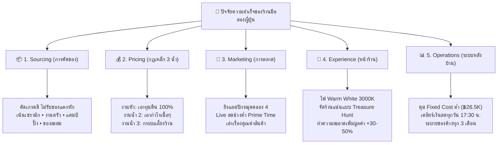

---


## 📎 ภาคผนวก

### A. สัดส่วนสินค้าที่แนะนำ (ปรับจากร้านเดิม)

| หมวด | ร้านเดิม | แนะนำใหม่ | เหตุผล |
|------|---------|----------|--------|
| งานครัว/เซรามิก | 30% | 25% | คงไว้ ขายได้ดี |
| **งานสะสม** | 10% | **20%** | ⬆️ ขายดีอันดับ 1 + Margin สูง |
| **เฟอร์นิเจอร์** | 10% | **15%** | ⬆️ ขายดีอันดับ 3 + ราคาสูง |
| แต่งบ้าน | 10% | 10% | คงเดิม |
| จิปาถะ | 10% | 10% | คงเดิม |
| เครื่องประดับ | 5% | 5% | คงเดิม |
| ของเล่น | 5% | 5% | คงเดิม |
| **เครื่องแต่งกาย** | 5% | **3%** | ⬇️ ค้างนาน 5 เดือน |
| **เครื่องมือช่าง** | 5% | **3%** | ⬇️ ตลาดเฉพาะเจาะจง |
| **เครื่องดนตรี** | 5% | **2%** | ⬇️ ตลาดเฉพาะเจาะจง |
| **กล้อง** | 5% | **2%** | ⬇️ ต้องมีความรู้เฉพาะ |

### B. แหล่งอ้างอิง

| แหล่ง | URL |
|-------|-----|
| OFM - กลยุทธ์ไลฟ์สด | ofm.co.th |
| Sellsuki - เทคนิคขาย FB | sellsuki.co.th |
| BangkokBank SME | bangkokbanksme.com |
| Thai Franchise Center | thaifranchisecenter.com |
| Japan Expo Thailand | japanexpothailand.com |
| Skooldio - การตลาดออนไลน์ | skooldio.com |

### C. เครื่องมือที่แนะนำ

| เครื่องมือ | ใช้ทำอะไร | ราคา |
|-----------|----------|------|
| Google Sheets | ระบบสต๊อก + บัญชี | ฟรี |
| Canva | ทำรูปโปรโมชั่น | ฟรี/Pro ฿329/เดือน |
| LINE OA | ดูแลลูกค้า | ฟรี (Basic) |
| CapCut | ตัดต่อวิดีโอ TikTok | ฟรี |
| Sellsuki / Page365 | ดูดคอมเมนต์ไลฟ์ | ฿599-999/เดือน |

---

> 📌 **เอกสารนี้จัดทำโดย AI Coach สำหรับร้าน Goods Japan (กูดส์ เจแปน)**
> อ้างอิงจากข้อมูลหุ้นส่วน + การวิจัยตลาด + กรณีศึกษาธุรกิจที่ประสบความสำเร็จ
> พร้อมให้คำปรึกษาเพิ่มเติมในทุกด้าน!
